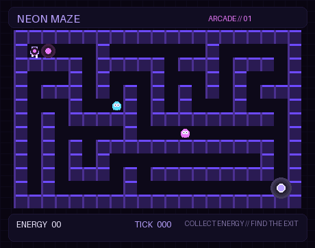

# NEON MAZE — Classic Arcade Edition

> Design specification and implementation plan for the GitHub contribution-powered Pixel Art maze.

**Status:** Design approved — implementation not started  
**Repository:** mahmoudewies/gh-space-shooter  
**Product direction:** Evolve the current Space Shooter fork into a classic top-down arcade maze. Preserve the existing contribution-data client and keep the old renderer intact until the maze prototype passes tests.

## 1. Product vision

NEON MAZE turns a GitHub user's contribution activity into a short, automatically generated arcade animation. A pixel character navigates a neon maze, collects energy pellets, avoids roaming ghosts, and reaches the exit.

**Deliverable:** an optimized animated GIF embedded in a GitHub Profile README. This is not a browser game and does not require visitors to interact with it.

### Gameplay loop

1. Short level-intro scene.
2. Player enters the purple neon maze.
3. Player follows a valid route and collects energy pellets.
4. Ghosts patrol the corridors.
5. Player reaches the exit.
6. Results scene displays the contribution score and MAZE CLEARED.

## 2. Visual direction

- Classic 2D top-down arcade maze.
- Crisp pixel-art geometry, consistent tile grid and sprite scale.
- Dark cyberpunk atmosphere with restrained neon accents.
- Original player and ghost sprites drawn in code with Pillow; no copied game sprites or logos.
- Proposed canvas: 560 × 320 px, subject to GIF-size testing.
- HUD inside the canvas: level, score, and contribution total.
- Target GIF size: ideally below 2 MB; optimize frame count, palette, and duration after visual QA.

### Cyberpunk Purple palette

| Role | Hex | Usage |
|---|---|---|
| Background | #090511 | Canvas and outer space |
| Maze / grid | #171329 | Empty cells and subtle structure |
| Primary neon | #6D4AFF | Maze walls and UI accents |
| Player lavender | #B9A2FF | Player sprite and highlights |
| Energy magenta | #E879F9 | Pellets, effects, exit pulse |
| Main text | #E8E5F0 | HUD and end card |

## 3. Gameplay specification

### Player
- Small original pixel character with a clear silhouette.
- Moves automatically; no keyboard input is required.
- Movement is tile-aligned and follows a valid path.
- Brief directional animation and subtle collection effects.

### Maze
- Classic corridors, turns, dead ends, and connected paths.
- Procedurally generated on a fixed grid.
- Every generated maze must have a verified route from spawn to exit.
- Generation is deterministic for the same normalized contribution input.

### Pellets / energy
- Contribution activity controls the number, placement, and visual intensity of collectible pellets.
- Higher-activity days may create brighter or bonus energy clusters.
- Pellets are placed only on reachable floor tiles.
- The mapping is a visual metaphor: one pellet does not mean one commit.

### Ghosts
- Original pixel ghost characters in purple and magenta variants.
- Patrol reachable corridors using pathfinding or predefined valid patrol routes.
- Ghosts add motion but must not trap the player or make completion impossible.
- Collision may trigger a brief visual flicker; the animation must still complete.

### Completion
- Player reaches the exit after collecting the required pellets or a configured quota.
- End card: MAZE CLEARED, contribution total, and BUILT THROUGH CONSISTENCY.
- Zero contributions must produce a valid low-activity maze, not an error.

## 4. GitHub data mapping

Use the existing GitHub GraphQL contribution-calendar query as the initial data source.

Expected daily fields:
- date
- contributionCount
- contributionLevel (NONE through FOURTH_QUARTILE)

| GitHub signal | Game representation |
|---|---|
| Daily contribution count | Pellet quantity / cluster size, with caps |
| Contribution level (0–4) | Pellet brightness / accent tier |
| Active days | Eligible pellet-bearing floor tiles |
| Weekly activity | Variation in room decoration / bonus clusters |
| Total contributions | Results-screen score |

**Critical design rule:** contribution values influence maze decoration and collectible placement, not raw wall placement. The maze generator owns connectivity and solvability. This prevents contribution patterns from producing an impossible maze.

### Normalization
- Normalize the latest 52 weeks into an ordered list of daily records.
- Preserve dates and counts for the results screen.
- Cap pellet density so active days do not overcrowd the board.
- Treat missing days as zero contributions.
- Use aggregate contribution-calendar data only; do not expose private repository names or commit messages.

### Authentication
- Local runs use GH_TOKEN in the environment.
- Scheduled workflow should read a repository secret named GH_TOKEN containing a token with the minimum permission needed to read the contribution calendar; verify read:user access before relying on it.
- Do not assume the default Actions GITHUB_TOKEN can read the user's contribution calendar.
- The workflow separately needs contents: write to commit the generated GIF.
- Never print or log token values.

## 5. Technical architecture

Keep the current contribution client reusable and implement the maze as a separate game module first. This avoids mixing new mechanics into the existing shooter classes before the maze is tested.

Proposed package layout:

    src/gh_space_shooter/
    ├── github_client.py          # Reuse contribution calendar retrieval
    ├── cli.py                    # Extend with explicit game selection
    ├── game/
    │   ├── ...                   # Existing shooter implementation; preserve initially
    │   └── maze/
    │       ├── __init__.py
    │       ├── config.py         # Grid, tile size, palette, animation settings
    │       ├── generator.py      # Deterministic connected maze generation
    │       ├── pathfinding.py    # BFS route validation and ghost/player routes
    │       ├── activity.py       # Contribution-to-pellet normalization
    │       ├── entities.py       # Player, ghosts, pellets, exit
    │       ├── scene.py          # Game state and frame progression
    │       └── renderer.py       # Pillow pixel-art frame renderer
    └── output/
        └── gif_provider.py       # Reuse or adapt existing GIF provider

    tests/
    ├── test_maze_generator.py
    ├── test_maze_pathfinding.py
    ├── test_activity_mapping.py
    └── test_maze_renderer.py

    assets/
    └── neon-maze.gif             # Generated output

The package can be renamed later if the project becomes maze-only. Avoid a broad rename during the first milestone.

## 6. CLI proposal

Keep the existing CLI backward-compatible during development and add an explicit game option.

Proposed usage:

    # Generate from live GitHub activity
    GH_TOKEN=... gh-space-shooter mahmoudewies --game maze --output assets/neon-maze.gif

    # Generate from saved contribution JSON for offline tests
    gh-space-shooter mahmoudewies --game maze --raw-input tests/fixtures/contributions.json --output assets/neon-maze.gif

Exact option wiring should follow existing CLI conventions after implementation begins. If a separate command is cleaner, document it before changing the public interface.

## 7. Automation and profile integration

### GitHub Actions
Create or replace the update workflow only after local rendering and tests pass.

1. Checkout the repository.
2. Set up the supported Python version.
3. Install the project and test dependencies.
4. Read GH_TOKEN from repository secrets.
5. Generate assets/neon-maze.gif.
6. Commit only when the generated file changes.
7. Use least-privilege workflow permissions (contents: write only for the commit job).

Run daily and via workflow_dispatch.

### Profile README

After the GIF is generated and visually verified, embed it in the profile repository mahmoudewies/mahmoudewies:

    

      
    

Do not update the profile README to point to a nonexistent or unverified GIF.

## 8. Implementation milestones

### Phase 0 — Design and repository preparation
- [x] Confirm Classic Arcade Maze direction.
- [x] Confirm Pixel Art and top-down presentation.
- [x] Define GitHub contribution mapping.
- [x] Define palette, gameplay loop, architecture, and acceptance criteria.
- [ ] Review existing renderer and tests before adding maze code.

### Phase 1 — Maze engine
- [ ] Implement deterministic grid generation.
- [ ] Guarantee spawn-to-exit connectivity.
- [ ] Add BFS pathfinding and route tests.
- [ ] Add contribution-driven pellet placement.

### Phase 2 — Arcade gameplay
- [ ] Implement player movement along a valid route.
- [ ] Add pellet collection and score progression.
- [ ] Add ghost patrol routes and collision animation.
- [ ] Add exit and completion state.

### Phase 3 — Pixel renderer
- [ ] Draw maze, sprites, pellets, HUD, and effects with Pillow.
- [ ] Render a complete frame sequence.
- [ ] Encode and optimize the animated GIF.
- [ ] Review readability, pacing, and file size.

### Phase 4 — Integration and automation
- [ ] Add CLI game selection / maze output path.
- [ ] Add offline fixture-based generation.
- [ ] Add unit tests and CI checks.
- [ ] Configure GH_TOKEN secret and validate live GraphQL access.
- [ ] Add scheduled and manual GIF generation.

### Phase 5 — Profile launch
- [ ] Generate the first live-data GIF.
- [ ] Verify the GIF from its raw GitHub URL.
- [ ] Update the profile README to embed the verified asset.
- [ ] Confirm the animation renders correctly on GitHub.

## 9. Definition of done

- [ ] Uses real contribution-calendar data for mahmoudewies.
- [ ] Same input produces the same maze layout.
- [ ] Every maze has a verified path from spawn to exit.
- [ ] All pellets are reachable.
- [ ] Player and ghosts animate without preventing completion.
- [ ] Output is a valid optimized animated GIF.
- [ ] Local generation works from live data and a JSON fixture.
- [ ] GitHub Actions updates pass successfully.
- [ ] Profile README embeds the verified GIF.

## 10. Scope boundaries

Included: Python + Pillow renderer, GitHub contribution-calendar integration, deterministic procedural maze, auto-play arcade animation, GIF output, and GitHub Actions automation.

Not included in the first release: browser-playable controls, hosted web game, user accounts, persistent game saves, private repository details, commit-message inspection, complex combat, multi-level campaign, or a full rewrite before the maze prototype passes tests.

---

**Approved design:** Classic top-down Pixel Art maze, Cyberpunk Purple palette, auto-play GIF, contribution-driven energy placement, and guaranteed solvability.
